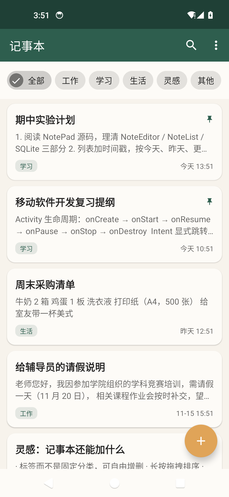
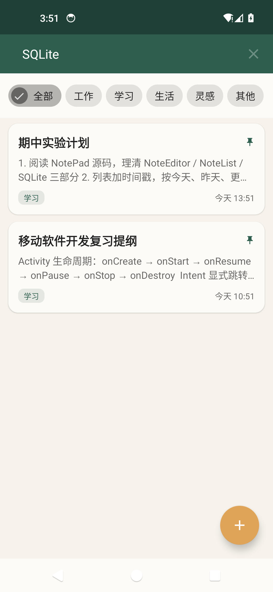
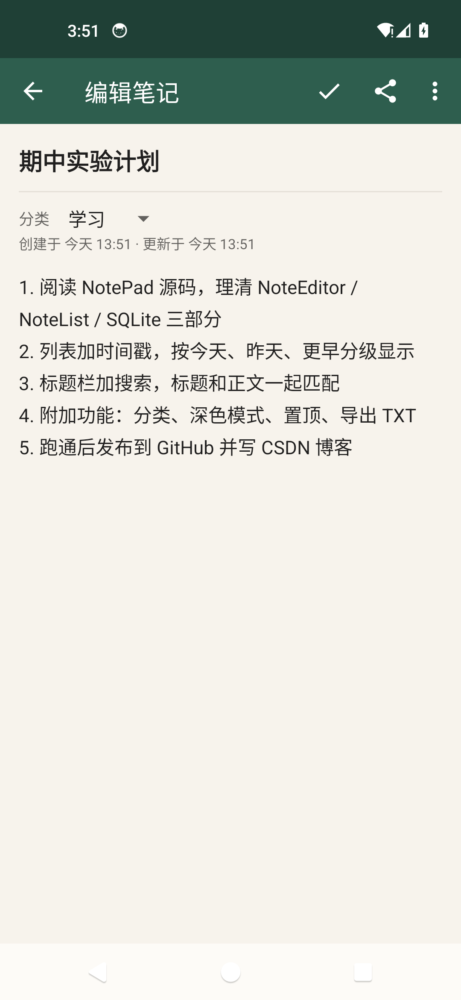
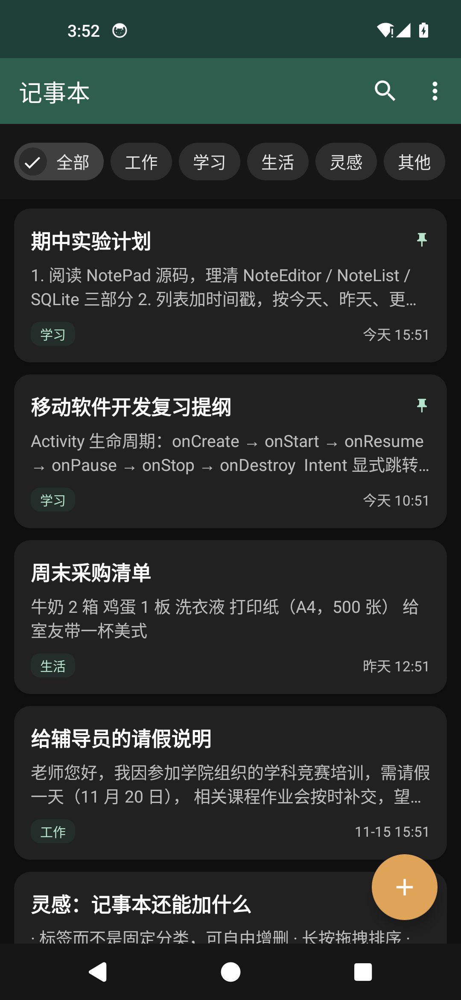
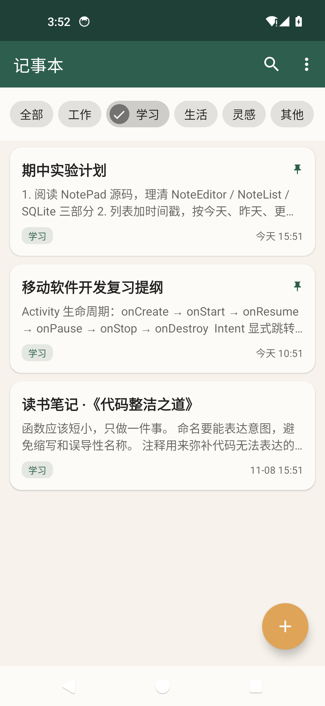

# Android 期中实验：基于 NotePad 的记事本应用扩展（时间戳 / 搜索 / 分类 / 深色模式）

> 本文是《移动软件开发》期中实验的配套博客草稿。
> 发布前请：① 把文中的【截图：…】替换成你自己的运行截图；② 在开头补一句个人信息；
> ③ 把文末的仓库地址换成你的 GitHub / Gitee 地址。

## 一、实验要求

本次实验基于开源的 NotePad 记事本应用进行功能扩展，要求：

**基本要求（必做）**

1. NoteList 界面中笔记条目增加**时间戳**显示；
2. 添加笔记**查询**功能（根据标题或内容查询）。

**附加要求（至少两项）**

UI 美化、导出/云备份、待办、偏好设置、笔记分类、多类型笔记、便签、OCR 等。

我选择实现的是：**笔记分类、深色模式、笔记置顶、分享与导出 TXT**，共 4 项。

---

## 二、运行效果

> 说明：以下图片在仓库 `docs/screenshots/` 目录下。发布到 CSDN 时，把这 5 张图直接拖进编辑器即可自动上传。











---

## 三、项目结构

```
app/src/main/java/com/example/notepadpro/
├── NotePadApp.java        # Application，启动时恢复深色模式
├── NoteListActivity.java  # 列表页：时间戳、搜索、分类、置顶
├── NoteEditActivity.java  # 编辑页：保存、分享、导出
├── NoteAdapter.java       # RecyclerView 适配器
├── Note.java              # 笔记实体
├── NoteDbHelper.java      # SQLite 增删改查
├── Prefs.java             # SharedPreferences
└── TimeUtils.java         # 时间戳格式化
```

整体仍然是经典 NotePad 的「列表 + 编辑 + SQLite」三段式结构，只是把 ListView 换成了
RecyclerView，并为每条笔记补充了 `created_at / updated_at / category / pinned` 四个字段。

---

## 四、数据库设计

`notepad.db` 中只有一张 `notes` 表：

| 字段 | 类型 | 说明 |
| --- | --- | --- |
| `_id` | INTEGER PK | 主键，自增 |
| `title` | TEXT | 标题 |
| `content` | TEXT | 正文 |
| `created_at` | INTEGER | 创建时间（毫秒） |
| `updated_at` | INTEGER | 更新时间（毫秒） |
| `category` | TEXT | 分类，默认「其他」 |
| `pinned` | INTEGER | 是否置顶 |

建表语句：

```java
db.execSQL("CREATE TABLE notes ("
        + "_id INTEGER PRIMARY KEY AUTOINCREMENT, "
        + "title TEXT NOT NULL DEFAULT '', "
        + "content TEXT NOT NULL DEFAULT '', "
        + "created_at INTEGER NOT NULL, "
        + "updated_at INTEGER NOT NULL, "
        + "category TEXT NOT NULL DEFAULT '其他', "
        + "pinned INTEGER NOT NULL DEFAULT 0)");
```

---

## 五、基本功能实现

### 5.1 时间戳显示

时间戳最容易踩的坑是「直接格式化一长串日期」，列表会显得很挤。我的做法是分级显示：
今天只显示时分，昨天显示「昨天 + 时分」，今年省略年份，更早才显示完整日期。

```java
public static String format(long millis) {
    Date date = new Date(millis);
    Calendar target = Calendar.getInstance();
    target.setTimeInMillis(millis);

    Calendar today = Calendar.getInstance();
    if (isSameDay(today, target)) {
        return "今天 " + new SimpleDateFormat("HH:mm", Locale.getDefault()).format(date);
    }

    Calendar yesterday = Calendar.getInstance();
    yesterday.add(Calendar.DAY_OF_YEAR, -1);
    if (isSameDay(yesterday, target)) {
        return "昨天 " + new SimpleDateFormat("HH:mm", Locale.getDefault()).format(date);
    }

    if (today.get(Calendar.YEAR) == target.get(Calendar.YEAR)) {
        return new SimpleDateFormat("MM-dd HH:mm", Locale.getDefault()).format(date);
    }
    return new SimpleDateFormat("yyyy-MM-dd HH:mm", Locale.getDefault()).format(date);
}
```

列表项布局里，时间戳放在卡片右下角，分类标签放左下角，两者用 `Space` 撑开：

```xml
<TextView
    android:id="@+id/tvTime"
    android:layout_width="wrap_content"
    android:layout_height="wrap_content"
    android:textColor="?android:attr/textColorSecondary"
    android:textSize="12sp" />
```

适配器绑定时调用 `TimeUtils.format(note.getUpdatedAt())` 即可。

### 5.2 笔记查询

查询用标题栏的 `SearchView`，把用户输入拼进 SQL 的 `LIKE` 条件，标题和正文同时匹配：

```java
StringBuilder sql = new StringBuilder("SELECT * FROM notes WHERE 1 = 1");
List<String> args = new ArrayList<>();

if (category != null && !"全部".equals(category)) {
    sql.append(" AND category = ?");
    args.add(category);
}

String kw = keyword == null ? "" : keyword.trim();
if (!kw.isEmpty()) {
    sql.append(" AND (title LIKE ? OR content LIKE ?)");
    String like = "%" + kw + "%";
    args.add(like);
    args.add(like);
}

sql.append(" ORDER BY pinned DESC, updated_at DESC");
```

`SearchView` 的 `onQueryTextChange` 里每输入一个字符就刷新一次列表，数据量小，体感上就是实时搜索：

```java
searchView.setOnQueryTextListener(new SearchView.OnQueryTextListener() {
    @Override
    public boolean onQueryTextChange(String newText) {
        keyword = newText;
        loadNotes();
        return true;
    }
    // ...
});
```

---

## 六、扩展功能

### 6.1 笔记分类

分类没有做成独立的表，直接在 `notes` 里存一个字符串字段，配合顶部的 `ChipGroup` 过滤。
`Chip` 是代码动态生成的，这样以后加分类只改一个数组：

```java
private static final String[] CATEGORIES = {"全部", "工作", "学习", "生活", "灵感", "其他"};

for (String item : CATEGORIES) {
    Chip chip = new Chip(this);
    chip.setText(item);
    chip.setCheckable(true);
    chipGroup.addView(chip);
    chip.setChecked(item.equals(category));
    chip.setOnClickListener(v -> {
        category = item;
        loadNotes();
    });
}
```

`ChipGroup` 设置 `singleSelection + selectionRequired`，保证任何时候都有且只有一个分类被选中，
不会出现「全部取消后列表空白」的尴尬状态。

### 6.2 深色模式

基于 Material 的 DayNight 主题，颜色全部放到 `values/` 与 `values-night/` 两套 `colors.xml` 里，
主题只引用颜色名，切换时系统自动取对应资源：

```xml
<style name="Theme.NotePadPro" parent="Theme.MaterialComponents.DayNight.NoActionBar">
    <item name="colorSurface">@color/surface</item>
    <item name="android:colorBackground">@color/background</item>
    ...
</style>
```

切换逻辑只有三行，`setDefaultNightMode` 会让 Activity 自动重建：

```java
boolean dark = !Prefs.isDark(this);
Prefs.setDark(this, dark);
AppCompatDelegate.setDefaultNightMode(dark
        ? AppCompatDelegate.MODE_NIGHT_YES
        : AppCompatDelegate.MODE_NIGHT_NO);
```

为了让冷启动也不闪白屏，在 `Application.onCreate` 里先恢复一次设置：

```java
public class NotePadApp extends Application {
    @Override
    public void onCreate() {
        super.onCreate();
        boolean dark = Prefs.isDark(this);
        AppCompatDelegate.setDefaultNightMode(dark
                ? AppCompatDelegate.MODE_NIGHT_YES
                : AppCompatDelegate.MODE_NIGHT_NO);
    }
}
```

### 6.3 笔记置顶

长按列表项弹出操作菜单，置顶后 `ORDER BY pinned DESC` 让置顶笔记永远排在最前。
置顶状态用列表项右上角一个小图钉标识。

### 6.4 分享与导出 TXT

分享用系统 `ACTION_SEND`，一行代码就能把笔记发给微信、QQ、邮件等任意应用：

```java
Intent send = new Intent(Intent.ACTION_SEND);
send.setType("text/plain");
send.putExtra(Intent.EXTRA_TEXT, buildShareText());
startActivity(Intent.createChooser(send, "分享笔记"));
```

导出则使用 Storage Access Framework（SAF），通过 `CreateDocument` 让用户自己选保存位置，
**完全不需要申请存储权限**，在 Android 10+ 的分区存储下也不会出问题：

```java
private final ActivityResultLauncher<String> exportLauncher =
        registerForActivityResult(new ActivityResultContracts.CreateDocument("text/plain"),
                uri -> { if (uri != null) writeToUri(uri); });
```

---

## 七、踩过的坑

**1. 空笔记被写进数据库**

一开始在 `onPause` 里无条件保存，结果点「新建」再直接返回，数据库里就多出一条空白笔记。
后来改成先判断标题和正文是否都为空：

```java
if (title.isEmpty() && content.isEmpty()) {
    return false;
}
```

**2. 返回键与 onPause 重复保存**

`onBackPressed` 里保存一次，`onPause` 又保存一次，会重复插入。
用一个 `dirty` 标志位记录「内容是否被修改过」，保存成功后置为 `false`，两个入口就不会打架。

**3. 分类下拉框初始化时误触发「已修改」**

`Spinner.setSelection()` 会回调 `onItemSelected`，把 `dirty` 置为 `true`，
导致「打开笔记什么都没改，更新时间却变了」。解决方法是先比较选中项和当前分类是否相同：

```java
String selected = CATEGORY_OPTIONS[position];
if (!selected.equals(category)) {
    category = selected;
    dirty = true;
}
```

**4. 深色模式下自绘颜色不跟随**

最初分类标签的背景和文字写死了浅色，切到深色模式后几乎看不清。
把这些颜色也放进 `values-night/colors.xml`，用 `@color/tag_bg`、`@color/tag_text` 引用即可。

---

## 八、总结

这次实验最大的收获不是某一个功能，而是体会到「看起来简单的记事本，细节非常多」：
时间戳怎么显示才不拥挤、搜索和分类怎么组合、返回时怎么保存才不产生脏数据、
深色模式怎么保证所有自绘控件都适配……这些问题在课本示例里都不会出现，只有真正写一遍才会遇到。

后续还可以继续扩展：把分类做成可增删的标签、接入 Room、用 `WorkManager` 做云备份、
或者加上 Markdown 预览。

---

**项目地址**：`https://github.com/<你的用户名>/NotePadPro`（或 Gitee 镜像地址）

**参考**

- NotePad 源码：<https://github.com/fjnu-cse/NotePad>
- NotePad 源码分析：<https://blog.csdn.net/llfjfz/article/details/67638499>
- Android 数据存储：<https://developer.android.google.cn/guide/topics/data/data-storage>
- Android 深色主题：<https://developer.android.google.cn/develop/ui/views/theming/darktheme>
